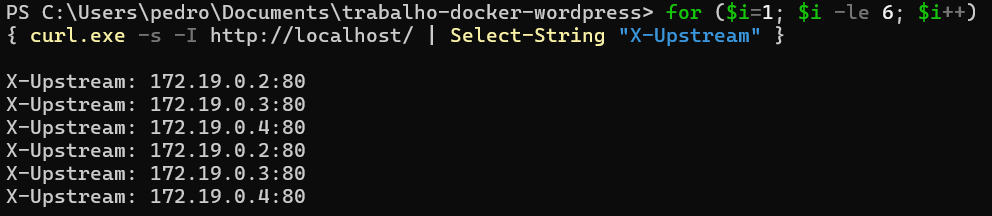
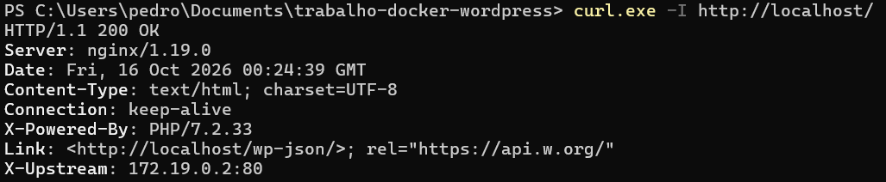

# WordPress com Múltiplas Instâncias — Nginx + Docker Compose

Trabalho 2 de Computação Distribuída: 5 contêineres com Nginx como balanceador
de carga para 3 instâncias do WordPress ligadas ao mesmo MySQL.

Integrantes:

- Daniel Enrique - 2323216
- Lucas Cardoso - 2218942
- Pedro Luis - 2315086

## Como rodar

    docker compose up -d
    docker compose ps

Acesso: http://localhost — completar a instalação do WordPress uma vez
(os 3 compartilham os mesmos arquivos e o mesmo banco, então o conteúdo é igual).

## Como testar

Repetir o comando e observar o header `X-Upstream` assumindo 3 IPs alternados
(os IPs dos contêineres WordPress). O mesmo pode ser visto no navegador em
F12 > Rede, inspecionando os cabeçalhos de resposta:

    curl -I http://localhost/

## Resultados obtidos (saída de console)

Subida dos 5 contêineres (`docker compose up -d --remove-orphans`):


5 contêineres no ar, nas imagens exigidas, só o Nginx expondo porta:

```
NAME         IMAGE                           STATUS                        PORTS
mysql        mysql:5.7                       Up (healthy)                  3306/tcp, 33060/tcp
nginx        nginx:1.19.0                    Up                            0.0.0.0:80->80/tcp
wordpress1   wordpress:5.4.2-php7.2-apache   Up (healthy)                  80/tcp
wordpress2   wordpress:5.4.2-php7.2-apache   Up                            80/tcp
wordpress3   wordpress:5.4.2-php7.2-apache   Up                            80/tcp
```

Mapeamento IP -> contêiner (prova de qual IP é quem):

```
/wordpress1 -> 172.18.0.3 172.19.0.2
/wordpress2 -> 172.18.0.4 172.19.0.3
/wordpress3 -> 172.18.0.5 172.19.0.4
/nginx -> 172.19.0.5
/mysql -> 172.18.0.2
```

Isolamento (requisito: sem acesso direto do host):

```
docker port nginx       # 80/tcp -> 0.0.0.0:80
docker port wordpress1  # (vazio = OK)
docker port mysql       # (vazio = OK)
```

Distribuição de carga — 6 requisições seguidas (round-robin perfeito):



Distribuição estendida — 12 requisições (mesmo padrão, obtido anteriormente):

```
req 01 : X-Upstream: 172.19.0.2:80
req 02 : X-Upstream: 172.19.0.3:80
req 03 : X-Upstream: 172.19.0.4:80
req 04 : X-Upstream: 172.19.0.2:80
req 05 : X-Upstream: 172.19.0.3:80
req 06 : X-Upstream: 172.19.0.4:80
req 07 : X-Upstream: 172.19.0.2:80
req 08 : X-Upstream: 172.19.0.3:80
req 09 : X-Upstream: 172.19.0.4:80
req 10 : X-Upstream: 172.19.0.2:80
req 11 : X-Upstream: 172.19.0.3:80
req 12 : X-Upstream: 172.19.0.4:80
```

Contagem em 30 requisições (10 para cada instância):

```
X-Upstream: 172.19.0.2:80    10
X-Upstream: 172.19.0.3:80    10
X-Upstream: 172.19.0.4:80    10
```

Cabeçalho completo de uma requisição (`curl -I http://localhost/`):



## Arquivos

- `docker-compose.yml` — os 5 serviços, redes `frontend` / `backend (internal)` e volumes.
- `nginx.conf` — config do enunciado (upstream + `add_header X-Upstream`).
- `wordpress/` — pasta compartilhada (`/var/www/html` nos WP, `/usr/share/nginx/html` no Nginx).
