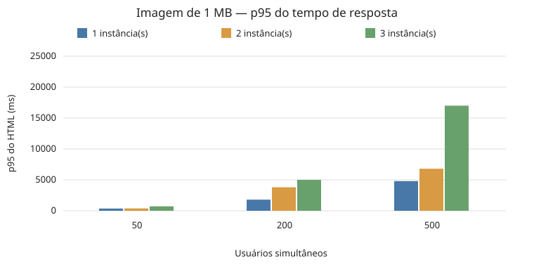
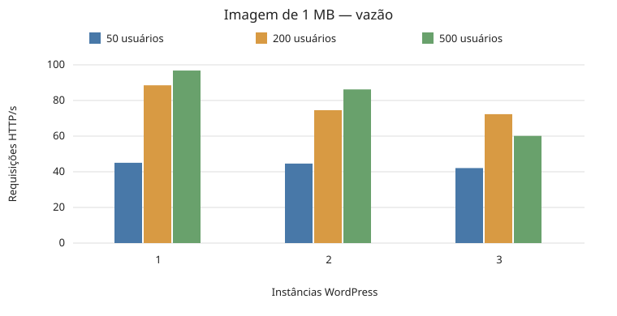
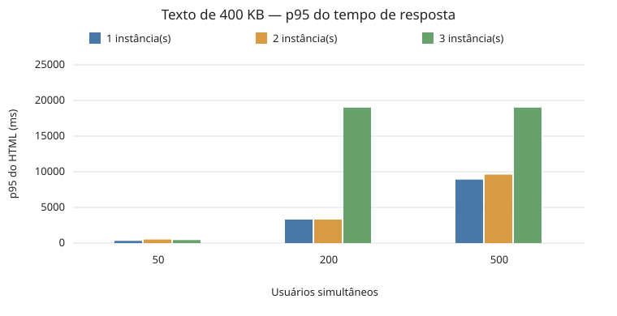
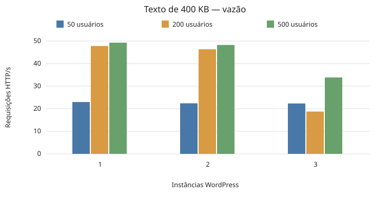
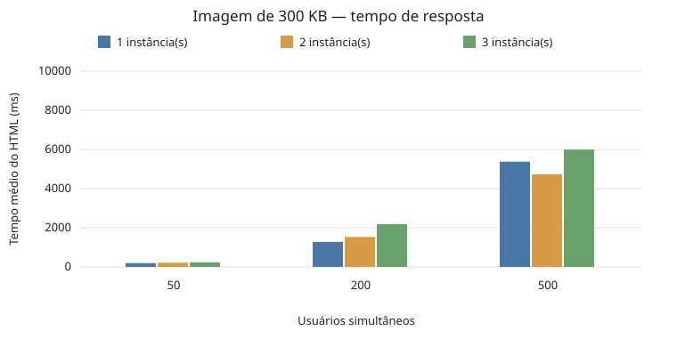
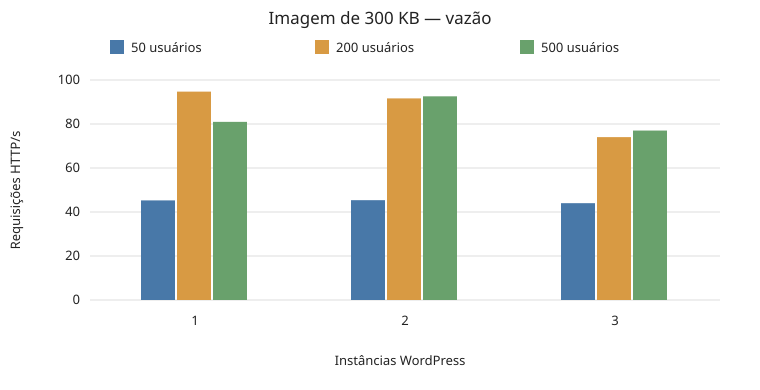
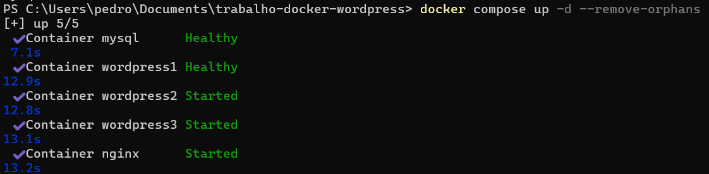

# WordPress com Nginx e Locust

Trabalhos 2 e 3 de Computação Distribuída.

Integrantes:

- Daniel Enrique — 2323216
- Lucas Cardoso — 2218942
- Pedro Luis — 2315086

## Como rodar

Com o Docker Desktop iniciado, execute na pasta do projeto:

```bash
docker compose up -d
```

Acesse http://localhost e conclua a instalação do WordPress, se for o primeiro uso.
O site tem três instâncias atrás do Nginx e um banco MySQL compartilhado.
Somente o Nginx publica a porta 80; o banco está em uma rede interna.

## Trabalho 3 — teste de carga

O teste usa Locust em um contêiner definido no mesmo Compose do Trabalho 2.
São **27 combinações**:

| Parâmetro            | Valores                                                                           |
| -------------------- | --------------------------------------------------------------------------------- |
| Conteúdo do post     | Imagem de aproximadamente 1 MB; texto de 400 KB; imagem de aproximadamente 300 KB |
| Usuários simultâneos | **50, 200 e 500**                                                                 |
| Instâncias WordPress | **1, 2 e 3**                                                                      |
| Entrada de usuários  | 50 por segundo                                                                    |
| Aquecimento          | 15 segundos após atingir a quantidade de usuários                                 |
| Coleta solicitada    | 60 segundos por combinação                                                        |

Ambiente utilizado: máquina com 8 GB de RAM e limite de **4 GB para o WSL/Docker**.
O limite efetivamente informado pelo Docker é registrado no relatório.

No Terminal do **macOS/Linux** ou no **Git Bash/WSL do Windows**, rode (com Bash e Docker Compose disponíveis):

```bash
bash executar.sh
```

O script prepara os três posts, alterna as instâncias, executa os testes e gera os
resultados. O Python roda na própria imagem do Locust; não há instalação adicional.
Em Macs Apple Silicon, as imagens antigas da aplicação usam emulação `linux/amd64`;
os resultados devem ser avaliados separadamente dos obtidos em outros computadores.
A execução completa pode levar **40 a 50 minutos ou mais**. Evite outras cargas pesadas.
Se interromper, execute o mesmo comando novamente: as combinações concluídas são reaproveitadas.

Cada usuário busca o HTML e, nos cenários com imagem, também baixa o arquivo original.
Há uma espera de 1 a 3 segundos entre visitas. CSS e JavaScript não fazem parte da carga.
As imagens são JPEGs gerados por código, com tamanho ajustado pela qualidade de compressão.
O texto possui 400.000 bytes. Os tamanhos reais aparecem no relatório.

Todas as arquiteturas usam a mesma configuração de 20 processos Apache por WordPress,
para limitar o consumo de memória. Nginx e MySQL continuam usando as imagens do Trabalho 2:
`nginx:1.19.0`, `mysql:5.7` e `wordpress:5.4.2-php7.2-apache`.
O Locust utiliza `locustio/locust:2.32.6`.

## Resultados

- **[Relatório completo](resultados/relatorio.html)** — abra no navegador; contém a tabela, os seis gráficos e a análise.
- **[Dados consolidados](resultados/resumo.csv)** — valores utilizados nos gráficos.

Os gráficos comparam o p95 do HTML por número de usuários e requisições por
segundo por número de instâncias. O p95 e a porcentagem de falhas estão na tabela.
RPS inclui HTML e imagem quando houver, portanto não equivale a visitas por segundo.
Alertas de CPU do gerador e de atraso da coleta também são registrados.
Os CSVs finais podem abranger parte do encerramento quando ele demora. O resumo
registra os intervalos e a taxa de requisições bem-sucedidas para ajudar na leitura.

Antes desta matriz, foram testadas cargas de **800, 1.200 e 1.500 usuários**, na mesma
máquina com limite de 4 GB. Elas provocaram estouros: erros HTTP, falhas de conexão
e download, encerramentos lentos e alertas de CPU do Locust. Por isso, os testes
principais foram refeitos com **50, 200 e 500 usuários**. Os ensaios com cargas
maiores são descritos no HTML, mas não são misturados aos gráficos da nova matriz.

Na matriz anterior, **800 usuários ainda causaram estouros** em oito das nove
execuções desse nível, com falhas entre aproximadamente 8,46% e 49,32% nos casos
afetados. Esse histórico foi preservado; a matriz atual usa cargas menores para
comparar o desempenho sem misturar os resultados das tentativas anteriores.

A nova coleta de **50, 200 e 500 usuários** concluiu **27/27 combinações sem falhas
de requisição**:

| Usuários | Execuções | Execuções com falhas | Alertas de CPU do Locust |
| -------- | --------: | -------------------: | -----------------------: |
| 50       |         9 |                    0 |                        0 |
| 200      |         9 |                    0 |                        0 |
| 500      |         9 |                    0 |                        1 |

O alerta ocorreu com imagem de 1 MB, três instâncias e 500 usuários. Ele indica
possível limitação do gerador, embora não tenha havido falhas HTTP nessa execução.
As cargas produziram diferenças de latência; por exemplo, com uma instância e
imagem de 1 MB, o tempo médio passou de aproximadamente 200 ms (50 usuários) para
1.412 ms (200 usuários) e 4.318 ms (500 usuários).

| Conteúdo         | Tempo de resposta                                    | Requisições por segundo                              |
| ---------------- | ---------------------------------------------------- | ---------------------------------------------------- |
| Imagem de 1 MB   |      |      |
| Texto de 400 KB  |    |    |
| Imagem de 300 KB |  |  |

Para apenas atualizar o relatório a partir de uma coleta existente:

```bash
bash executar.sh --relatorio
```

Para regenerar somente os gráficos a partir do CSV, sem Docker ou dados brutos:

```bash
python testes/relatorio.py --csv resultados/resumo.csv resultados
```

Para experimentar uma carga isolada sem substituir os resultados da entrega:

```bash
bash executar.sh --piloto 1200
```

O piloto testa os três conteúdos e as três arquiteturas, salvando tudo em
`.dados/piloto-1200/resultado/`. Com 1.200 usuários ainda ocorreram falhas e alertas
de CPU do Locust; esse nível não foi adotado como substituto da carga final.

## Arquivos

- `docker-compose.yml` e `nginx.conf`: serviços e balanceamento.
- `executar.sh`: execução dos testes em Bash (Windows com Git Bash/WSL, macOS e Linux).
- `testes/`: script do Locust, preparação dos posts, configuração Apache e gerador do relatório.
- `resultados/`: relatório, CSV consolidado e gráficos.
- `.dados/`: arquivos temporários e CSVs do Locust, ignorados pelo Git.
- `imagens/`: prints do Trabalho 2.

## Trabalho 2 — funcionamento do balanceamento

Para verificar o cabeçalho que identifica a instância usada:

```bash
curl -I http://localhost/
for i in 1 2 3 4 5 6; do
    curl -s -I http://localhost/ | grep -i 'X-Upstream'
done
```

Subida dos cinco contêineres:



Resposta HTTP e alternância entre as três instâncias:


Para parar o projeto: `docker compose down`. O volume do banco é preservado.
